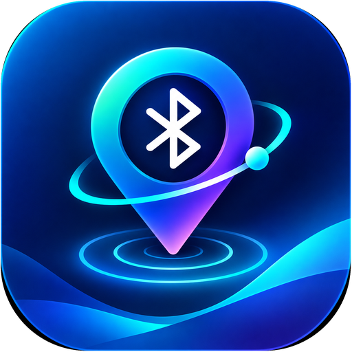

<div align="center">



# Bluetooth Tracker

**Find nearby Bluetooth devices. See how close they might be. Review where you detected a tag.**


[Features](#features) · [Screenshots](#screenshots) · [Build](#build) · [Privacy](https://github.com/malikawaisabbas7/Bluetooth-Tracker-App/blob/main/docs/privacy-policy.md)

</div>

Bluetooth Tracker is a native Android app for discovering nearby Bluetooth Low Energy devices and supported tracking tags. Scan results show signal strength, device details, and estimated proximity. When location is available, the app can show where your phone previously detected a device.

## Screenshots

| Nearby scan | Detected tags | Device details |
| :--: | :--: | :--: |
|  |  |  |

| Scan history | Tracking settings | Tracker guide |
| :--: | :--: | :--: |
|  |  |  |

The screenshots show the Android app with fictional demo sightings.

## Features

| Feature | What it does |
| --- | --- |
| **Nearby BLE scanning** | Lists supported tags and other BLE devices with signal indicators and device details. |
| **Proximity estimates** | Uses Bluetooth signal strength to estimate distance. Walls, interference, and device orientation affect the estimate. |
| **Scan history** | Records detection times and can attach your phone’s location to a sighting. Maps show where the phone detected a device. |
| **Optional background tracking** | Uses a foreground service to scan periodically and can notify you about repeated sightings of supported trackers across locations. |
| **Settings and controls** | Offers multiple languages and themes, scan duration, distance units, and the ability to ignore individual devices. |

Detection depends on permissions, Bluetooth availability, and the device’s advertisements. Coverage varies by tracker and Android device.

## Technologies

| Layer | Tools |
| --- | --- |
| Android UI | Kotlin, Fragments, XML Views, View Binding, Material Components, Jetpack Navigation |
| State and storage | Coroutines, Flow, ViewModel, Hilt, Room, Preferences DataStore |
| Bluetooth and maps | Android BLE APIs, Google Play services fused location, osmdroid, OpenStreetMap |
| Subscriptions | Google Play Billing, Node.js verification service, Android Publisher API |
| Verification | JUnit, Android Lint, Room instrumentation tests, Jetpack Macrobenchmark, Node test runner |

## Build

Use Android Studio with its bundled JDK and install Android SDK 36. The app supports Android 8.0 and later.

```bash
./gradlew :app:assembleDebug
./gradlew :app:testDebugUnitTest :app:lintDebug
```

On Windows, use `gradlew.bat`. For the verifier tests, run `node --test billing-server/server.test.mjs` from the repository root.

### Subscription setup

Checkout requires a deployed HTTPS verifier. The Android app grants premium only after the server checks the purchase with Google Play. Verification expires within 15 minutes or at Play’s subscription expiry, whichever comes first. An unavailable verifier leaves the free features usable and checkout disabled or shows an error when verification fails.

1. Enable the Android Publisher API and IAM Service Account Credentials API in Google Cloud. Give a dedicated Play service account the app-level Play Console permissions needed to read and acknowledge subscriptions.
2. Deploy the container in `billing-server/` to Cloud Run with an attached runtime service account. Grant that identity `roles/iam.serviceAccountTokenCreator` on the dedicated Play service account only. Set `PLAY_SERVICE_ACCOUNT` to that account’s email. The runtime uses short-lived credentials.
3. Set `PLAY_PACKAGE_NAME` and `PLAY_PRODUCT_ID` if your Play setup uses different identifiers. The default product is `premium_weekly`. The Android identifiers and weekly base plan must match Play Console.
4. Build with `-PbillingVerificationUrl=https://YOUR-SERVICE.run.app/verify`. The endpoint accepts a Play purchase token over HTTPS, so expose only the verifier route through a rate-limited ingress and set bounded concurrency and instance limits. Exclude request bodies from logs and tracing.
5. Test purchases, pending payments, cancellation, expiry, and restoration on a Google Play internal test track before release.

See [Google Play’s subscription API](https://developers.google.com/android-publisher/api-ref/rest/v3/purchases.subscriptionsv2) for subscription state definitions.

## Privacy and support

BLE sightings and their associated phone locations stay on the device. When using maps, the app requests tiles from OpenStreetMap. Paid subscriptions send the purchase token to the verification service, which checks it with Google Play.

[Privacy policy](https://github.com/malikawaisabbas7/Bluetooth-Tracker-App/blob/main/docs/privacy-policy.md) · [Report an issue](https://github.com/malikawaisabbas7/Bluetooth-Tracker-App/issues)

GitHub issues are public. Leave out purchase tokens, personal details, Bluetooth addresses, and location history.

To enable in-app email support, build with `-PsupportEmail=YOUR-PUBLIC-SUPPORT-ADDRESS` and update the privacy policy with that contact and the actual retention practice.

## Release checklist

The Android 10 device check confirmed a complete filtered BLE scan with the display off. A separate test on that phone confirmed that simulated sightings triggered a notification, applied the cooldown, excluded out-of-window observations, and handled the **Ignore** action. End-to-end detection with a physical tracker and live Google Play purchases still need testing.

1. **Confirm the Play listing and signing setup.** Match the app ID and version code to the intended Play listing. Generate a signed release Android App Bundle using your upload key and configure [Play App Signing](https://support.google.com/googleplay/android-developer/answer/9842756). Keep signing keys and credentials outside the repository.
2. **Configure billing if offering subscriptions.** Confirm what premium access provides, then deploy the verifier, configure the active product and base plan in Play Console, and build with the HTTPS verifier URL. Validate purchase, cancellation, and restoration on an internal test track. Builds without a verifier URL leave checkout disabled.
3. **Complete the store listing and App content declarations.** Choose an [app icon](Assets/Play%20Store/Icons), a [feature graphic](Assets/Play%20Store/Feature%20Graphics), and [screenshots](Assets/Play%20Store/Screenshots). Complete Data safety and any applicable permission and foreground-service declarations. Use a [public, non-editable privacy policy webpage](https://support.google.com/googleplay/android-developer/answer/9859455) in the Play listing and app. The [Markdown policy](docs/privacy-policy.md) is maintained here, with GitHub Pages disabled.
4. **Test and submit through Play Console.** Install the signed build through an internal test track, check alerts with a supported physical tracker, and complete any account-specific closed testing requirements shown in your dashboard. Then [submit the production release for review](https://support.google.com/googleplay/android-developer/answer/9859348).
